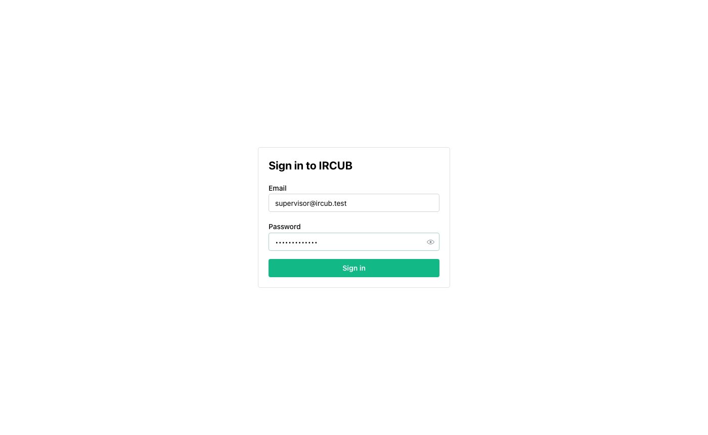
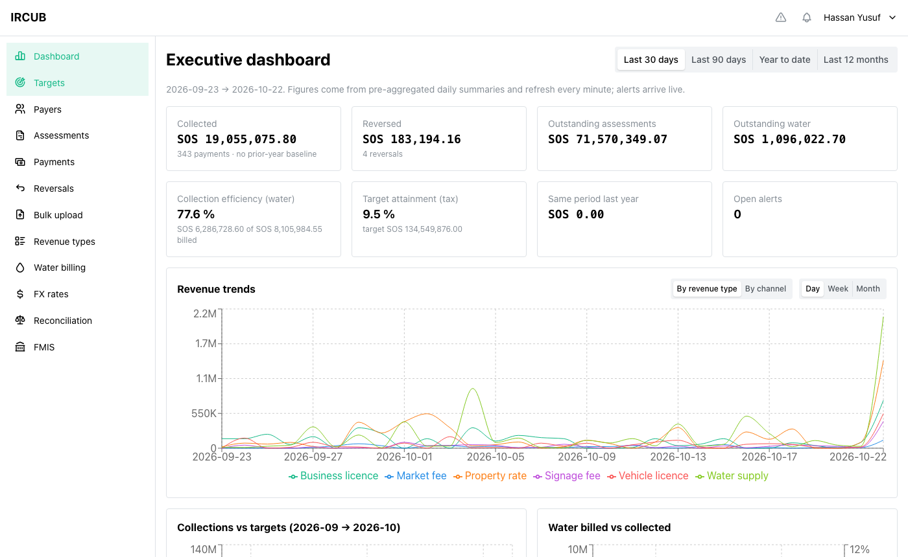
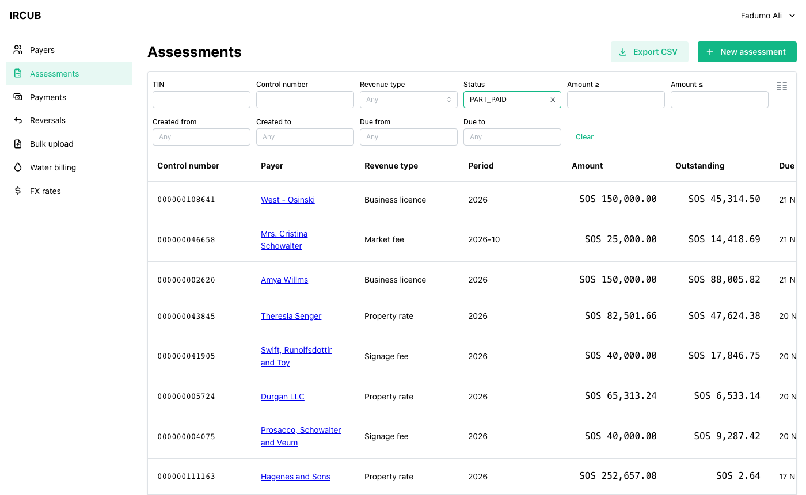
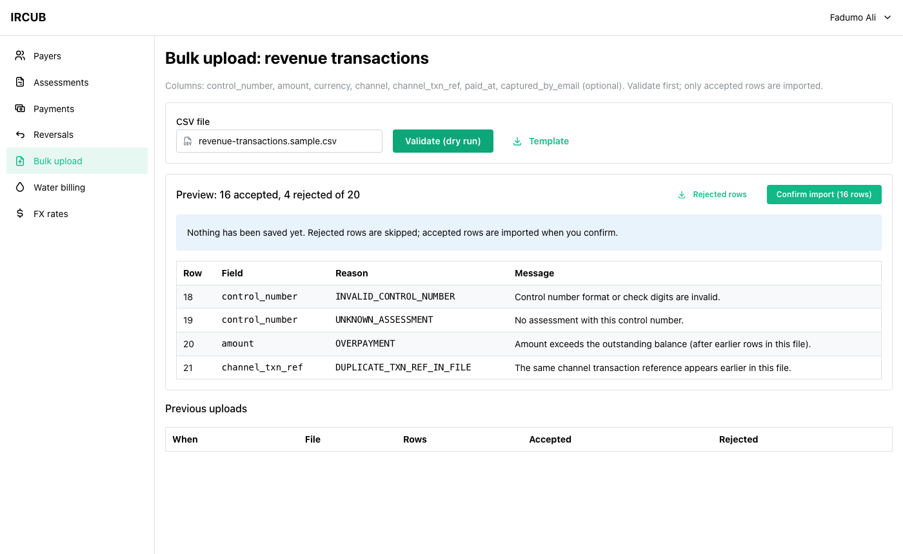
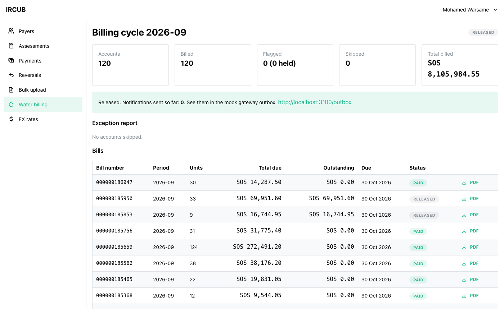
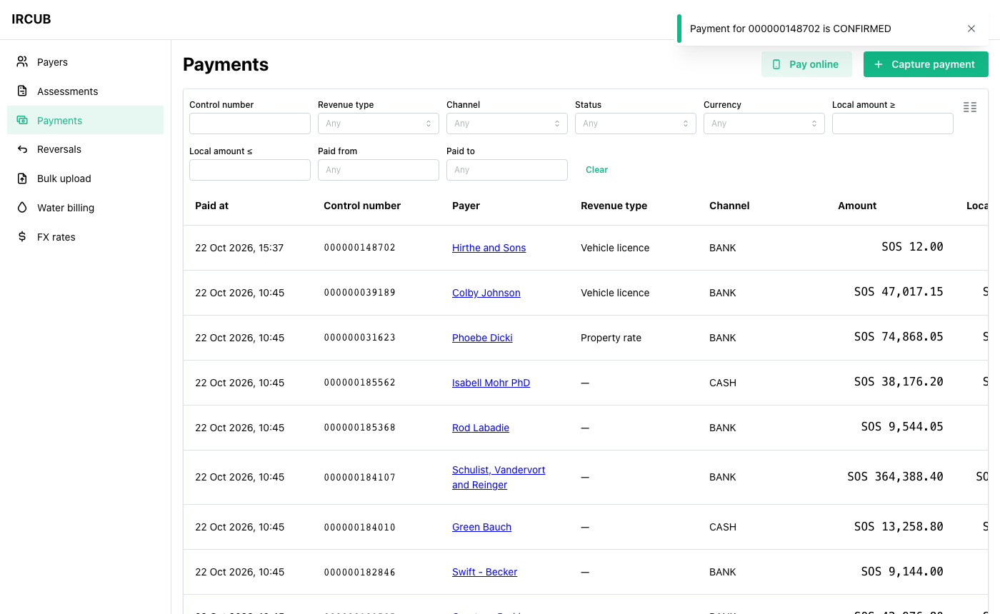
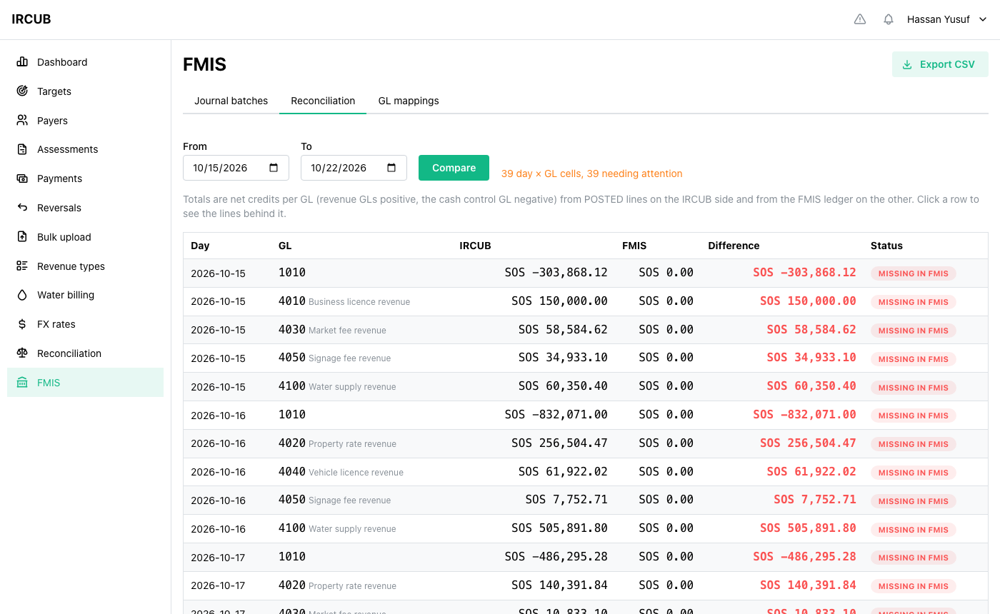
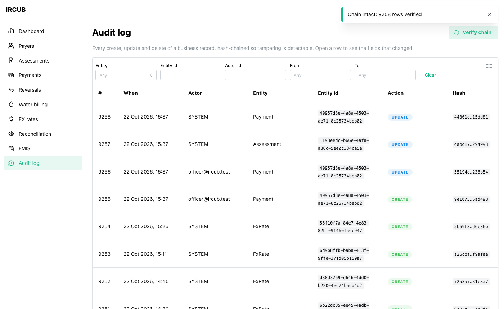
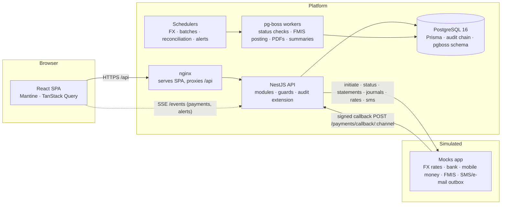

# IRCUB — Integrated Revenue Collection & Utility Billing Platform (POC)

[](https://github.com/Abdirahman-Hashi/ircub-poc/actions/workflows/ci.yml)

A working prototype of the platform described in `docs/BRIEF.md`: a payer registry with
unique TINs and duplicate detection, tax assessments with check-digit control numbers, a
validated bulk uploader, water metering with tiered billing and PDF bills, multi-channel
payments in SOS and USD with signed callbacks and retries, daily reconciliation against bank
and mobile-money statements and against the FMIS general ledger, a tamper-evident audit log,
and an executive dashboard with a forecast and live anomaly alerts. Built in five days as a
take-home assessment for Farsight Africa Technologies; every architectural decision is in
`docs/DECISIONS.md`, every assumption below and in `docs/ASSUMPTIONS.md`, and the engineering
rules the code is held to in `docs/ENGINEERING-STANDARDS.md`.

## Demo links

| What                        | Where                                                                                             |
| --------------------------- | ------------------------------------------------------------------------------------------------- |
| Docker Compose (primary)    | `docker compose up --build` → http://localhost:8080 (see [Getting started](#getting-started))     |
| Hosted demo (Render + Neon) | **https://ircub-web.onrender.com** (free tier: the first request after idle takes about a minute) |
| Swagger UI                  | http://localhost:3000/docs (Compose/dev) · `https://ircub-api.onrender.com/docs`                  |
| Mock outbox (SMS/e-mail)    | http://localhost:3100/outbox · mock API docs at `/docs` on the mocks                              |
| OpenAPI / Postman           | `docs/openapi.json` · `docs/postman/` (collection + environment, auto-login)                      |
| ERD and data model          | `docs/erd.svg` · `docs/erd.md` (Mermaid) · `docs/data-model.md`                                   |

## Screenshots

|                                                                                                                  |                                                                                                            |
| ---------------------------------------------------------------------------------------------------------------- | ---------------------------------------------------------------------------------------------------------- |
|  Login with optional TOTP                                                 |  Executive dashboard: KPIs, trends, forecast, live alerts   |
|  Assessments with the brief's filters and CSV export  |  Bulk upload dry run: per-row rejection reasons |
|  Billing cycle with the exception report |  Online payment flipping to CONFIRMED over SSE     |
|  IRCUB vs FMIS per GL and day with drill-down |  Audit log with field diffs and chain verification           |

## Technology stack

| Layer             | Choice                                                                                            | Why                                                                                                       |
| ----------------- | ------------------------------------------------------------------------------------------------- | --------------------------------------------------------------------------------------------------------- |
| Monorepo          | pnpm workspaces (`apps/api`, `apps/web`, `apps/mocks`, `packages/shared`)                         | One lockfile, shared contract types between API and web                                                   |
| API               | NestJS 11, TypeScript strict                                                                      | Modules, DI and decorators map cleanly onto the brief's modules; interfaces for every external system     |
| Database          | PostgreSQL 16 via Prisma 6                                                                        | Unique constraints and partial indexes carry the idempotency guarantees; typed queries; migrations in git |
| Jobs and schedule | pg-boss + `@nestjs/schedule`                                                                      | Retries with backoff and crons on Postgres alone, no Redis to operate                                     |
| Real time         | Server-Sent Events                                                                                | One-directional updates (payment status, alerts) need no WebSocket handshake or sticky sessions           |
| Auth              | Passport JWT (15 min) + rotating httpOnly refresh cookie, argon2id, TOTP (`otplib`)               | Short-lived tokens, reuse detection, optional 2FA as the brief asks                                       |
| Money             | `decimal.js`, `Decimal(18,2)` amounts, `Decimal(18,6)` rates, HALF_EVEN                           | Never a float in a ledger                                                                                 |
| Web               | Vite, React 18, Mantine 7, mantine-react-table, TanStack Query + Router, zod, Recharts            | Functional, consistent screens fast; server-side pagination and filters                                   |
| Mocks             | Second NestJS app (FX, bank, mobile money, FMIS, SMS, e-mail, outbox)                             | Swappable for real integrations behind the same interfaces                                                |
| Docs              | `@nestjs/swagger` → `docs/openapi.json` → Postman; Mermaid ERD                                    | Generated from the code, so they cannot drift                                                             |
| Quality           | ESLint (type-aware, standards rules), Prettier, husky + lint-staged, commitlint, GitHub Actions   | The standards are enforced, not advisory                                                                  |
| Tests             | Jest + supertest (api, e2e on a throwaway Postgres), Jest (mocks), Vitest + Testing Library (web) | Every rule function unit-tested; every brief flow covered end to end                                      |
| Deploy            | Docker Compose; Render (Docker + static) + Neon                                                   | Compose for evaluation, free hosted tier for a link                                                       |

## Architecture



Request path: controller → `@RequirePermission` guard (permissions resolved per request
through the role hierarchy) → service → Prisma client wrapped by the audit extension, which
appends a hash-chained `AuditLog` row for every mutation of a business model. Pure business
rules (tariffs, consumption, check digits, FX rounding, settlement decisions, z-scores,
regression) live in `*.rules.ts` files without framework imports.

## Getting started

Prerequisites: Docker Desktop. For local development also Node 22 (`.nvmrc`) and pnpm 10+
(`corepack enable`).

### One command (Docker Compose)

```bash
cp .env.example .env         # optional; defaults work. Change POSTGRES_PORT if 5432 is taken
docker compose up --build    # postgres, api (migrates + seeds on first boot), mocks, web
```

Open http://localhost:8080 and log in with a user below. The api container runs
`prisma migrate deploy`, then the seed once (`SEED_ON_BOOT=true`, skipped once a previous
seed has completed), so a second `docker compose up` keeps your data. `docker compose down -v`
resets.

### Local development

```bash
pnpm install                             # also builds @ircub/shared, installs git hooks
docker compose up -d postgres            # Postgres on $POSTGRES_PORT (default 5432)
pnpm --filter api prisma migrate dev     # apply migrations (reads the root .env)
pnpm --filter api prisma db seed         # roles, users, 12 months of demo data (idempotent)
pnpm dev                                 # api :3000, mocks :3100, web :5173
```

The seed is deterministic (`faker.seed(42)`) and idempotent: reference data is upserted,
demo data is skipped when it already exists. To start over: `pnpm --filter api prisma
migrate reset` (drops the database, re-applies migrations and reseeds). Run the seed with the
mocks up so the mock channels learn the seeded online payments for reconciliation demos.

### Seeded users

Password for all six, on Docker Compose and local development: `Passw0rd!2026`. The hosted
demo runs with its own password (`SEED_PASSWORD`, generated by Render and supplied with the
submission), so the public repository never reveals a working login to the live site.

| Email                 | Role                  | Lands on                                                           |
| --------------------- | --------------------- | ------------------------------------------------------------------ |
| admin@ircub.test      | System Administrator  | Dashboard; Administration (users, roles matrix, SoD rules, config) |
| supervisor@ircub.test | Revenue Supervisor    | Dashboard; approves reversals, runs reconciliation, posts to FMIS  |
| officer@ircub.test    | Revenue Officer       | Payers, assessments, payments, bulk upload                         |
| water@ircub.test      | Water Billing Officer | Water accounts, readings, billing cycles                           |
| auditor@ircub.test    | Auditor               | Dashboard (read-only); audit log with chain verification           |
| customer1@ircub.test  | Taxpayer/Customer     | My account: own assessments, bills, statements, pay online         |

### Demo scenarios

- **Online payment amounts** (Payments → Pay online, or My account as the customer): any
  amount ending in `.00` is confirmed by the mock's signed callback after ~3 s; `.99` is
  declined; `.77` sends no callback, so the status-check job confirms it on its third check;
  `.66` sends no callback and the status endpoint fails, so after three checks the payment
  is PERMANENTLY FAILED, every holder of `payments.supervise` is e-mailed (mock outbox) and
  an alert lights the bell. Administration → Demo helper repeats this.
- **Bulk upload**: `docs/samples/revenue-transactions.sample.csv` has 20 rows, 16 valid and
  4 that each show a different rejection (bad check digit, unknown assessment, missing
  channel reference, over-payment). `docs/samples/meter-readings.sample.csv` has 20
  readings including one below the previous reading (rejected), one valid rollover, a future
  date and an unknown meter.
- **Billing**: Billing cycles → Run cycle for the current month flags the three seeded
  abnormal readings; clear or confirm (hold) each, then release to render PDFs and send
  SMS/e-mail to the mock outbox.
- **FMIS**: the seed leaves the two most recent batches PENDING and FAILED; Retry the failed
  one; FMIS → Reconciliation compares posted totals with the mock ledger per GL and day.
- **Audit**: Audit log → Verify chain recomputes every hash from genesis and compares the
  tail with the chain head.

## Running tests

```bash
pnpm lint && pnpm typecheck                      # ESLint standards rules + tsc, every package
pnpm test                                        # unit: api (Jest), mocks (Jest), web (Vitest)
docker compose -f docker-compose.test.yml up -d --wait
pnpm test:e2e                                    # migrates + seeds the throwaway DB, supertest suites
pnpm --filter api test:cov                       # unit coverage report
pnpm --filter api bench                          # /dashboard/trends latency on the seed
```

CI (`.github/workflows/ci.yml`) runs lint, typecheck, unit and e2e against a Postgres service
container and builds the three Docker images on every push.

| Suite    | Count           | What it proves                                                                                                                                                                                                                                                                                                                                                                             |
| -------- | --------------- | ------------------------------------------------------------------------------------------------------------------------------------------------------------------------------------------------------------------------------------------------------------------------------------------------------------------------------------------------------------------------------------------ |
| API unit | 174             | Every `*.rules.ts` function (tariffs, consumption, arrears, check digits, FX rounding, settlement, SoD, hash chain, z-scores, regression, CSV validation) and the invariant-bearing services                                                                                                                                                                                               |
| API e2e  | 64 in 11 suites | Login/refresh/logout/MFA, 401 vs 403, custom roles, SoD on both paths and per record, registry and duplicates, control numbers, bulk upload 16/4, water readings → cycle → held bill → release → PDF → notification, online payments with callbacks and permanent failure, channel reconciliation, FMIS build/post/catch-up/reversal/retry/reconcile, dashboard, forecast, alerts over SSE |
| Mocks    | 13              | Signing, scenario triggers, statement perturbation, FMIS journal rules                                                                                                                                                                                                                                                                                                                     |
| Web      | 23              | Nav filtering by permission, permission matrix, tariff validation, payment status copy, forecast rows, alerts panel, audit diff                                                                                                                                                                                                                                                            |

## Module walkthrough

| Brief requirement                                                                | Where                                                                                                             | Test                                                                |
| -------------------------------------------------------------------------------- | ----------------------------------------------------------------------------------------------------------------- | ------------------------------------------------------------------- |
| 1 · Six hierarchical roles, permissions configurable in the DB                   | `GET/PUT /roles/:id/permissions`, role `parentId`; Administration → Roles (matrix)                                | `rbac.e2e-spec` "custom role grants on the next request"            |
| 1 · Custom roles and segregation of duties                                       | `SodRule` + `assertNoConflict` on role assignment, permission edits, re-parenting; per-record capturer ≠ approver | `rbac.e2e-spec` (3 paths), `revenue.e2e-spec` "SoD on reversals"    |
| 1 · Secure login, password policy, optional 2FA, role-based menus                | `/auth/*`, lockout, history, TOTP; nav filtered by permission, `/403` guard                                       | `auth.e2e-spec` (policy, lockout, rotation, MFA), `nav.rules.spec`  |
| 2 · Unique TIN, one payer → many obligations and accounts                        | `POST /payers` (mod-11 TIN), relations in the schema                                                              | `ids.rules.spec`, `registry.e2e-spec`                               |
| 2 · Duplicate detection with review                                              | phone/e-mail/national id normalised; Payers → Duplicate review                                                    | `payers.rules.spec`, `registry.e2e-spec`                            |
| 2 · 360° payer profile                                                           | `GET /payers/:id` (assessments, water accounts, bills, payments, balances)                                        | `registry.e2e-spec`                                                 |
| 3 · Revenue types with rates and GL codes                                        | `/revenue-types`, effective-dated GL mappings                                                                     | `revenue-types.e2e-spec`                                            |
| 3 · Assessments with a unique control number                                     | `POST /assessments`, ISO 7064 MOD 97-10 check digits, unique at the DB                                            | `ids.rules.spec`, `revenue.e2e-spec`                                |
| 3 · Bulk uploader: validate before save, summary with reasons                    | `POST /bulk-uploads/revenue-transactions?dryRun`, Bulk upload page                                                | `bulk-uploads.rules.spec` (every reason), `bulk-upload.e2e-spec`    |
| 3 · Tamper-evident audit of who/when/before/after                                | Prisma audit extension → `AuditLog` hash chain; `GET /audit`, `/audit/verify`; Audit log page                     | `audit.rules.spec`, `audit.service.spec`, `rbac.e2e-spec`           |
| 3 · Advanced filters                                                             | `/assessments`, `/payments` filters (payer, type, amount range, channel, status, dates), CSV export               | `revenue.e2e-spec`, `registry.e2e-spec`                             |
| 4 · Readings single and CSV; below-previous rejected unless rollover/replacement | `POST /readings`, `/bulk-uploads/meter-readings`; `computeConsumption`                                            | `readings.rules.spec`, `water-billing.e2e-spec`                     |
| 4 · Monthly cycle: tiered tariff, arrears, payments applied                      | `POST /billing-cycles`; `tariffs.rules`, `billing.rules`                                                          | `tariffs.rules.spec`, `billing.rules.spec`, e2e                     |
| 4 · Bill PDF and mock SMS/e-mail                                                 | release job → pdfkit → mock gateway → `Notification` rows                                                         | `water-billing.e2e-spec`                                            |
| 4 · Abnormal consumption > 200 % of 3-month average blocks release               | `evaluateAbnormal`, FLAGGED bills, held bills                                                                     | `readings.rules.spec` (200 % vs 201 %), e2e                         |
| 4 · Statement with running balance                                               | `GET /water-accounts/:id/statement[.pdf]`, `/me/...`                                                              | `statements.rules.spec`, e2e                                        |
| 5 · Mock bank and mobile money, dynamic FX from a separate mock                  | `apps/mocks`; `FxRateProvider` with stale fallback; HALF_EVEN conversion                                          | `money.rules.spec`, `fx.service.spec`                               |
| 5 · Initiate → callback → verify → update                                        | `POST /payments/initiate`, signed `POST /payments/callback/:channel`, settlement under row lock, SSE              | `channels.rules.spec`, `settlement.rules.spec`, `channels.e2e-spec` |
| 5 · Retry up to 3, permanently failed, supervisor notified                       | `payment.status-check` job, `PAYMENT_STATUS_RETRY_LIMIT`, e-mail + alert                                          | `payment-status-check.service.spec`, `channels.e2e-spec`            |
| 5 · Daily channel reconciliation vs statement file                               | cron 01:00, `POST /reconciliation/runs`, statement upload, CSV export                                             | `reconciliation.rules.spec`, `channels.e2e-spec`                    |
| 6 · Configurable revenue type → GL mapping                                       | `/fmis/gl-mappings` (effective-dated)                                                                             | `fmis.rules.spec`, `fmis.e2e-spec`                                  |
| 6 · Daily journal batches, four statuses                                         | cron 00:30, `/fmis/batches/*`, catch-up window                                                                    | `journal-batch.service.spec`, `fmis.e2e-spec`                       |
| 6 · Post to mock FMIS, store reference, never post twice                         | poster job, `JournalLine.paymentId` unique, one batch per day index                                               | `fmis-poster.service.spec`, `fmis.e2e-spec`                         |
| 6 · Reconciliation screen per GL and day with drill-down                         | `/fmis/reconciliation`, FMIS → Reconciliation                                                                     | `fmis.rules.spec`, `fmis.e2e-spec`                                  |
| 7 · Trends by type and channel; collections vs targets; billed vs collected      | `/dashboard/*` from daily summaries; Dashboard                                                                    | `dashboard.rules.spec`, `dashboard.e2e-spec`                        |
| 7 · Next-quarter forecast (linear regression or better)                          | OLS by default (R², caveat), Holt's smoothing on toggle                                                           | `dashboard.rules.spec`                                              |
| 7 · Real-time anomaly alerts; pre-aggregated data; async updates                 | z-scores every 5 min, event alerts, SSE `alert.created`, summaries rebuilt hourly + debounced                     | `alerts.service.spec`, `dashboard.e2e-spec` (SSE delivery)          |

## Assumptions

### Domain

- We assume the local currency is the Somali Shilling (SOS) because the case study is a
  Federal Member State; it is a single config value, so changing it affects only seed data
  and labels.
- We assume "revenue transactions" in the bulk uploader are **collections/payments** captured
  outside the online channels (cashier, bank branch, agent) referencing an existing control
  number, because that is the only interpretation that needs validation against existing
  records; if assessments are meant instead, the same CSV pipeline accepts a second template.
- We assume assessments and water bills are denominated in SOS and USD payments are converted
  at the retrieved rate at capture time; if bills can be denominated in USD, `Bill.currency`
  is already present and the conversion flips direction.
- We assume one billing cycle per calendar month per tariff category, run manually by a Water
  Billing Officer (not auto-scheduled), because the brief says "run a monthly billing cycle".
- We assume water revenue is itself a revenue type (code `WATER`) with its own GL code so FMIS
  posting treats water collections like any other revenue.
- We assume "3-month average" for abnormal consumption means the mean of the three most
  recent monthly consumption figures for the same meter, excluding the current one.
- We assume revenue targets are set per month per revenue type by the Ministry (seeded), and
  "collection efficiency" = billed vs collected for water, collected vs target for tax.
- We assume the channel statement file is a CSV with columns `txn_ref, date, amount,
currency, control_number, status`, produced by the mock channel; a real bank's format would
  only change the parser.
- We assume the FMIS accepts a JSON journal batch `{ batchId, date, lines: [{ glCode, debit,
credit, currency, reference }] }` and returns `{ fmisReference }`; it is a mock.

- We assume a TIN check digit of "10" is simply not issued (the body is regenerated) because
  the brief asks for a single check digit; if an alphabetic check character (ISBN-style `X`)
  is preferred, only `ids.rules.ts` changes.
- We assume phone numbers without a country code are local Somali numbers (`+252`) because
  the case study is a Federal Member State; the code is a `SystemConfig` value.
- We assume a bulk-upload row that would over-pay an assessment is rejected rather than
  capped, because partial acceptance of a row would silently change the uploader's intent.
- We assume a bulk file keeps each row's real channel (cash/bank/mobile money) and is
  identified by `bulkUploadId`, because channel reconciliation (phase 4) matches on the
  channel's own reference; if "BULK" must be the channel, it is one constant change.

- We assume water payments always quote a bill's control number, so "unallocated payments"
  do not exist and arrears are the account's outstanding balance, Σ own charges − Σ payments
  over earlier released bills, because each bill's `totalDue` already rolls up the arrears
  before it and summing `totalDue − paidAmount` per bill would charge the same debt once per
  cycle (found in the 2026-10-22 self-review); if account-level prepayments are needed,
  `Bill.paymentsApplied` is the field to fill.
- We assume paying the latest bill in full settles the arrears it rolled up (older bills keep
  their own `paidAmount` but the account balance is zero), because customers pay one control
  number; if per-bill settlement is required, payments must cascade onto older bills.
- We assume a confirmed abnormal flag means "hold this bill back", so the cycle is released
  without it and the bill goes out on its own when the flag is later cleared, because a
  single unresolved investigation must not block a whole month's billing; if held bills
  should instead be cancelled, the clear-flag path changes.
- We assume a ROLLOVER reading is only plausible when the new value is below the previous
  one and within the dial's capacity, because otherwise a mislabelled normal reading would
  bill a whole dial of water; if meters can skip past zero between reads, the bound relaxes.
- We assume one bill per account per calendar month covering every reading in the month
  (consumption summed, previous reading = last reading before the month); if a utility wants
  bills per reading, the cycle loop changes, not the tariff rules.
- We assume a reading can be flagged only against the current meter and its direct predecessor,
  because older generations have different dials; if a longer chain is wanted, the lookup
  follows `replacesMeterId` recursively.

- We assume the local amount of an online payment is fixed at initiation (converted at the
  rate in force then) because the payer agrees to that amount; a callback that reports a
  different amount or currency is recorded as FAILED with reason `AMOUNT_MISMATCH` rather than
  re-applied. If the Ministry wants the settled amount to win, the settlement service would
  re-convert on confirmation.
- We assume a confirmed channel payment whose ledger target can no longer accept it (for
  example settled by cash while the channel was pending) is recorded FAILED with the ledger's
  reason for a supervisor to resolve, because the money has already left the payer and
  silently dropping it would hide a credit; a production system would create an unallocated
  credit instead.
- We assume "retry up to 3 times" means three status checks in total (configurable as
  `PAYMENT_STATUS_RETRY_LIMIT`), spaced by exponential backoff from
  `PAYMENT_STATUS_RETRY_DELAY_SECONDS`, and that the first check waits
  `PAYMENT_STATUS_CHECK_DELAY_SECONDS` for the callback; if the brief meant three retries after
  a first attempt, only the limit default changes.
- We assume channel reconciliation matches on the channel's transaction reference only and
  compares amounts in the original currency (what the channel settled), with `CONFIRMED` and
  `REVERSED` payments of that UTC day on the IRCUB side; if the channel's statement day were
  defined differently (value date), the `paidAt` window in `ReconciliationService` changes.
- We assume a failed statement fetch produces a `FAILED` reconciliation run rather than no
  run, so the daily history has no silent gaps.
- We assume the supervisor escalation for permanently failed payments is an e-mail to every
  user holding `payments.supervise` plus an in-app bell fed by SSE, and that the Alert record
  arrives in phase 6 as the prompt says.
- We assume the mocks keep channel state in memory, so the seed re-registers the last 60 days
  of confirmed online payments with the mocks on every run when they are reachable; when the
  mocks are down the seed logs it and the statements only know payments made live.

### Security

- We assume the role-level SoD rule (`reversals.capture` ⟂ `reversals.approve`) applies to every
  user including System Administrators, because a superuser exemption would defeat the control;
  if administrators must be able to do both, remove the seeded rule rather than add a bypass.
- We assume Revenue Officers capture reversal requests and Revenue Supervisors approve them
  (brief: "View/Approve/Reverse"), so Supervisor cannot inherit Officer without breaking the
  SoD rule; the seeded hierarchy is therefore Water Billing Officer → Revenue Officer. If the
  Ministry wants Supervisor ⊇ Officer, `reversals.capture` must move to a role outside that chain.
- We assume the System Administrator holds every permission except `reversals.capture`
  (brief lists only user/role/config management for admins; the extra permissions make the
  demo navigable). If a reviewer wants a pure admin role, trim `ROLE_SEEDS`.
- We assume an audit row written immediately after its mutation (not in the same transaction)
  is acceptable for the POC; a production deployment would use a transactional outbox.
- We assume 2FA is optional and user-enrolled (TOTP authenticator app), because the brief says
  "optional two-factor authentication".
- We assume the Auditor role is view-only on _everything_ including configuration screens.
- We assume a Taxpayer/Customer user is linked to exactly one Payer (`User.payerId`) and sees
  only that payer's data.

- We assume the revenue type's `glCode` is only the default copied into the first GL mapping
  (effective from 1970 so historical batches resolve) and that the mapping table is the sole
  source of truth afterwards, because effective dating needs history the revenue type row
  cannot hold; if a reviewer wants the type's code to override, `resolveMapping` would take it
  as a fallback.
- We assume a journal batch for day D also sweeps confirmed payments from the previous
  `FMIS_CATCH_UP_DAYS` (31) days that still have no journal line, because late callbacks and
  back-dated captures would otherwise never reach the FMIS (one COLLECTIONS batch per day
  forbids a second batch for their own day); the line keeps the payment's own `paidAt` for
  traceability while the journal date is the batch date. If the FMIS requires journals dated
  on the payment day, the index becomes `(batch_date, kind, sequence)` and catch-up batches
  get their own date.
- We assume journal lines are denominated in the local currency (the posted amount is the
  payment's `localAmount`), because the FMIS ledger is kept in SOS; the original USD amount
  and rate stay on the payment for the audit trail.
- We assume a late `SUCCESS` from a channel for a payment IRCUB had already marked `FAILED`
  or `PERMANENTLY_FAILED` must be applied, because the channel did collect the money; if the
  Ministry prefers manual handling, the settlement rule returns `DUPLICATE` for those states
  and a supervisor alert replaces the automatic application.
- We assume one COLLECTIONS batch per day (partial unique index) and that a payment confirmed
  after its day's batch was built waits for a manual build or is reported as
  `DUPLICATE_POSTING`, because a second batch for the same day would blur the daily
  reconciliation; if late payments must post the same day, the builder would append lines to
  the existing PENDING batch instead.
- We assume a reversal line swaps debit and credit with a positive amount (not a negative
  amount), because most ledgers reject negative postings; the FMIS payload stays balanced either
  way.
- We assume a REVERSAL batch per approved reversal, dated the approval day, and that the
  original batch is marked REVERSED only when all its lines are reversed; otherwise it stays
  POSTED with per-line `reversed` flags.
- We assume an approved reversal of a payment whose line is still PENDING or FAILED simply
  removes the line before posting, since nothing reached the FMIS yet.
- We assume reconciliation compares net credits (credits minus debits) per GL and day on both
  sides, so revenue GLs read positive and the cash control GL negative, because one signed
  figure is easier to compare than separate debit and credit columns; the drill-down shows the
  lines either way.
- We assume batches left PENDING without a job (seeded with the FMIS down, or a crash between
  build and enqueue) should be re-enqueued when the API boots, because posting is idempotent at
  both ends.

- We assume "same-hour cumulative" anomaly baselines can be approximated from the daily
  summaries scaled by the fraction of the UTC day elapsed (today-so-far vs trailing daily
  totals × elapsed fraction), because keeping hourly summaries would multiply the aggregate
  rows by 24 for a POC; if intra-day shape matters (lunch dips, weekend patterns), an hourly
  summary table replaces the scaling. No alert is raised with fewer than 5 baseline days or a
  zero standard deviation.
- We assume reversals land on the day the reversal was approved (not the day of the original
  payment) in the summaries, because that is when the ledger changed; the KPI "reversed" for a
  range therefore counts decisions in that range.
- We assume target attainment covers tax revenue types only (WATER has bills, so collection
  efficiency is its measure), and that the seeded targets are 110 % of each type's average
  month so the demo shows realistic attainment rather than 100 %.
- We assume the forecast fits the last 12 complete calendar months (the current month is
  partial and excluded) and that OLS is the default model: with 12 points an interpretable
  line with an R² is more honest than a seasonal model; Holt's smoothing is the alternative
  the UI can toggle. Projections are floored at zero.
- We assume one open alert per type per day for anomalies and per entity for event alerts is
  the right de-duplication; acknowledging clears the way for a new one.
- We assume "async updates" are satisfied by the hourly rebuild plus a 5-second debounced
  rebuild of any day touched by a payment, reversal or billing release, rather than a
  per-event incremental update, because a full-day recompute is cheap (one query per table)
  and cannot drift from the source rows.

### Security (phase 4)

- We assume the shared HMAC secret with the channels (`MOCK_SHARED_SECRET`) stands in for the
  per-channel credentials a real bank or mobile-money provider would issue; the callback is
  the only unauthenticated business endpoint and is throttled separately.
- We assume passing the short-lived access token as a query parameter to the SSE endpoint is
  acceptable because `EventSource` cannot send headers and the token lives 15 minutes; a
  production deployment would use a one-time stream ticket.

### Operations

- We assume the business "day" for jobs, summaries and reconciliation is the UTC calendar date
  because all services run in one timezone-agnostic container set; if the Ministry needs
  local-time days, the date helpers in `common/` take a timezone parameter.
- We assume one API process at a time (pg-boss workers, the in-process SSE event bus, and the
  30 s SystemConfig cache are all single-instance) because the POC deploys one container; if
  horizontally scaled, the event bus would move to Postgres LISTEN/NOTIFY and the cache would
  shrink or move to the database.
- We assume Node 22 LTS (not 20, which is end-of-life) and NestJS 11 / Prisma 6 satisfy the
  brief's "modern stack" expectation; if a reviewer requires the exact majors in the phase
  prompt, only `.nvmrc`, the Dockerfiles and a handful of config imports change.
- We assume the hosted demo may cold-start (~1 min) because it runs on free tiers; Docker
  Compose is the primary evaluation path.
- We assume scheduled jobs only need to run while the API is up (no external scheduler).

## Known limitations

- **Simulated integrations.** Bank, mobile money, FX, FMIS, SMS and e-mail are mocks with
  invented contracts; real providers would plug in behind the same interfaces but with their
  own formats and credentials. Mock state is in memory, so restarting the mocks forgets
  payments the API initiated earlier (the seed re-registers its own).
- **Single process.** pg-boss workers, the SSE event bus and the 30 s config cache are
  in-process; scaling out would move the bus to Postgres LISTEN/NOTIFY.
- **Audit rows are written after their mutation in a separate transaction**; a rolled-back
  interactive transaction leaves its audit rows behind (a production system would use an
  outbox). `updateMany` snapshots record the patch as written, not Prisma operators.
- **Anomaly baselines** scale daily totals by the fraction of the day elapsed; intra-day
  shape is not modelled. The forecast has no seasonality or confidence bands.
- **Ledger model.** Paying the latest water bill settles the arrears it rolled up; older
  bills are superseded (they keep their own paid amount and no longer accept payments). There
  is no account-level prepayment or credit note.
- **Journal date vs payment date.** Late payments are posted in the next day's batch with
  the batch date as journal date (the line keeps the payment's own date).
- **Deliberately out of scope** (D25/D26): multi-state tenancy, i18n, mobile-first layouts,
  production secrets management, horizontal scaling, real document formats.
- **Hosted demo** sleeps after 15 minutes idle; the first request takes about a minute (open
  the web URL and wait for the "API is waking up…" overlay to clear). Scheduled jobs (FX
  refresh, nightly batches, reconciliation, summaries, alerts) run only while the api is awake;
  the UI buttons do the same work on demand. Its file storage is ephemeral. Docker Compose is
  the evaluation route.

## Security notes

Done: argon2id hashes, password policy with history and lockout, rotating httpOnly refresh
cookies with reuse detection, optional TOTP, per-request permission resolution, configurable
and per-record segregation of duties, HMAC-signed callbacks compared in constant time and
throttled, `whitelist`/`forbidNonWhitelisted` validation on every DTO, file size and MIME
limits with a row cap from configuration, helmet and strict CORS, secrets only through the
validated environment, an append-only hash-chained audit log, and ownership checks on every
customer endpoint.

A production deployment would add: a secrets manager and key rotation, encryption of the
TOTP secret at rest, failed-TOTP counting towards lockout, one-time tickets for the SSE
stream instead of a query-string token, a least-privilege database role (INSERT/SELECT only
on `audit_log`, documented in the migration), a transactional outbox for audit rows, rate
limiting at the edge, and a security review of the mock contracts against the real providers.

## AI assistance declaration

Claude Code (Anthropic) was used throughout this project under the candidate's direction:
to scaffold the monorepo and modules, to write boilerplate (DTOs, controllers, Prisma
models, Docker and CI files), to draft tests and documentation, and as a pair-programming
assistant while implementing the business rules, driven by the phase prompts in
`.claude/commands/` and the rules in `CLAUDE.md`. The work ran in eight phases (0 scaffold,
1 identity and audit, 2 registry and revenue, 3 water billing, 4 payments and FX, 5 FMIS,
6 dashboard, 7 deliverables) plus a self-review and fix pass recorded in
`docs/REVIEW-2026-10-22.md` and `docs/PROGRESS.md`. Every line was reviewed by the
candidate, Abdirahman Hashi, who takes responsibility for the design decisions
(`docs/DECISIONS.md`), the code and its trade-offs, and can explain any part of it.

## Licence and author

Copyright © 2026 Abdirahman Hashi. Submitted for assessment to Farsight Africa Technologies;
all rights reserved, no licence is granted beyond evaluation of this submission. No real
personal, taxpayer or financial data is used anywhere: every name, number and amount is
generated.
