# Entity relationship diagram

Generated from `apps/api/prisma/schema.prisma` by `pnpm --filter api erd` (do not edit by
hand). `docs/erd.svg` is the rendered copy; `docs/data-model.md` explains the bounded
contexts and invariants.

```mermaid
erDiagram
  User {
    String id PK
    String email UK
    String passwordHash
    String fullName
    UserStatus status
    Boolean mfaEnabled
    String mfaSecret "optional"
    DateTime passwordChangedAt
    Int failedLoginCount
    DateTime lockedUntil "optional"
    String payerId "optional"
    DateTime createdAt
    DateTime updatedAt
  }
  PasswordHistory {
    String id PK
    String userId
    String passwordHash
    DateTime createdAt
  }
  RefreshToken {
    String id PK
    String tokenHash UK
    String userId
    DateTime expiresAt
    DateTime rotatedAt "optional"
    DateTime revokedAt "optional"
    DateTime createdAt
  }
  Role {
    String id PK
    String code UK
    String name
    String description "optional"
    String parentId "optional"
    Boolean isSystem
    DateTime createdAt
    DateTime updatedAt
  }
  Permission {
    String id PK
    String code UK
    String description
    String group
  }
  RolePermission {
    String roleId
    String permissionId
  }
  UserRole {
    String userId
    String roleId
  }
  SodRule {
    String id PK
    String permissionACode
    String permissionBCode
    String description
    DateTime createdAt
  }
  Payer {
    String id PK
    String tin UK
    PayerType type
    String name
    String nationalId "optional"
    String registrationNo "optional"
    String phone
    String email "optional"
    String address "optional"
    PayerStatus status
    String createdById
    DateTime createdAt
    DateTime updatedAt
  }
  DuplicateFlag {
    String id PK
    String payerId
    String matchedPayerId
    DuplicateMatchField matchField
    DuplicateFlagStatus status
    String reviewedById "optional"
    DateTime reviewedAt "optional"
    String note "optional"
    DateTime createdAt
  }
  RevenueType {
    String id PK
    String code UK
    String name
    RateType rateType
    Decimal rate
    String glCode
    Boolean active
    String description "optional"
    DateTime createdAt
    DateTime updatedAt
  }
  Assessment {
    String id PK
    String controlNumber UK
    String payerId
    String revenueTypeId
    String period "optional"
    Decimal baseAmount "optional"
    Decimal amount
    Currency currency
    DateTime dueDate
    AssessmentStatus status
    Decimal paidAmount
    String createdById
    String notes "optional"
    DateTime createdAt
    DateTime updatedAt
  }
  Payment {
    String id PK
    String controlNumber
    String assessmentId "optional"
    String billId "optional"
    String payerId
    PaymentChannel channel
    String channelTxnRef "optional"
    Decimal amount
    Currency currency
    Decimal fxRate
    DateTime fxRateAt "optional"
    Decimal localAmount
    PaymentStatus status
    Int statusCheckAttempts
    DateTime paidAt "optional"
    String capturedById "optional"
    String bulkUploadId "optional"
    Json channelRequestPayload "optional"
    Json callbackPayload "optional"
    String failureReason "optional"
    DateTime lastStatusCheckAt "optional"
    DateTime permanentlyFailedAt "optional"
    DateTime createdAt
    DateTime updatedAt
  }
  Reversal {
    String id PK
    String paymentId
    String reason
    String capturedById
    ReversalStatus status
    String approvedById "optional"
    DateTime decidedAt "optional"
    String decisionNote "optional"
    DateTime createdAt
    DateTime updatedAt
  }
  BulkUpload {
    String id PK
    BulkUploadKind kind
    String fileName
    String storedPath
    Int totalRows
    Int accepted
    Int rejected
    Json summary
    String uploadedById
    DateTime createdAt
  }
  ChannelStatement {
    String id PK
    PaymentChannel channel
    DateTime statementDate
    String fileName
    String storedPath
    Int lineCount
    String importedById "optional"
    DateTime createdAt
  }
  ChannelStatementLine {
    String id PK
    String statementId
    String txnRef
    DateTime date
    Decimal amount
    Currency currency
    String controlNumber
    String status
  }
  ReconciliationRun {
    String id PK
    PaymentChannel channel
    DateTime runDate
    String statementId "optional"
    ReconciliationRunStatus status
    Int matched
    Int missingInIrcub
    Int missingInChannel
    Int amountMismatch
    String runById "optional"
    String error "optional"
    DateTime createdAt
  }
  ReconciliationLine {
    String id PK
    String runId
    ReconciliationLineStatus status
    String txnRef
    String paymentId "optional"
    String statementLineId "optional"
    Decimal ircubAmount "optional"
    Decimal channelAmount "optional"
    String note "optional"
  }
  FxRate {
    String id PK
    Currency base
    Currency quote
    Decimal rate
    DateTime asOf
    String source
  }
  TariffCategory {
    String id PK
    String code UK
    String name
    Decimal fixedCharge
    Boolean active
    DateTime createdAt
    DateTime updatedAt
  }
  TariffTier {
    String id PK
    String categoryId
    Int fromUnit
    Int toUnit "optional"
    Decimal ratePerUnit
  }
  WaterAccount {
    String id PK
    String accountNumber UK
    String payerId
    String tariffCategoryId
    String serviceAddress
    WaterAccountStatus status
    DateTime openedAt
    DateTime createdAt
    DateTime updatedAt
  }
  Meter {
    String id PK
    String serial UK
    String accountId
    Int maxDigits
    Int initialReading
    DateTime installedAt
    MeterStatus status
    String replacesMeterId "optional"
    DateTime createdAt
    DateTime updatedAt
  }
  MeterReading {
    String id PK
    String meterId
    DateTime readingDate
    Int readingValue
    ReadingType type
    Int consumption
    ReadingSource source
    String capturedById
    String bulkUploadId "optional"
    Boolean abnormal
    String abnormalReason "optional"
    DateTime createdAt
  }
  BillingCycle {
    String id PK
    String period UK
    BillingCycleStatus status
    String runById
    DateTime runAt
    String releasedById "optional"
    DateTime releasedAt "optional"
    Json stats
    DateTime createdAt
    DateTime updatedAt
  }
  Bill {
    String id PK
    String billNumber UK
    String cycleId
    String accountId
    String payerId
    DateTime periodStart
    DateTime periodEnd
    Int previousReading
    Int currentReading
    Int consumption
    Json tierBreakdown
    Decimal consumptionCharge
    Decimal fixedCharge
    Decimal arrears
    Decimal paymentsApplied
    Decimal totalDue
    Decimal paidAmount
    Currency currency
    BillStatus status
    Boolean flagged
    String flagReason "optional"
    String flagNote "optional"
    String pdfPath "optional"
    DateTime dueDate
    DateTime releasedAt "optional"
    DateTime createdAt
    DateTime updatedAt
  }
  Notification {
    String id PK
    NotificationChannel channel
    String to
    String subject "optional"
    String body
    NotificationStatus status
    String relatedType "optional"
    String relatedId "optional"
    DateTime sentAt "optional"
    String error "optional"
    DateTime createdAt
  }
  AuditLog {
    BigInt id PK
    BigInt seq UK
    String actorId "optional"
    String actorEmail
    String entity
    String entityId
    AuditAction action
    Json before "optional"
    Json after "optional"
    String ip "optional"
    String userAgent "optional"
    DateTime createdAt
    String prevHash
    String hash
  }
  AuditChainHead {
    Int id PK
    BigInt lastSeq
    String lastHash
  }
  SystemConfig {
    String key PK
    Json value
    String description "optional"
    DateTime updatedAt
    String updatedById "optional"
  }
  ControlNumber {
    BigInt id PK
    ControlNumberPurpose purpose
    DateTime createdAt
  }
  GlMapping {
    String id PK
    String revenueTypeId
    String glCode
    String glName
    DateTime effectiveFrom
    String createdById "optional"
    DateTime createdAt
    DateTime updatedAt
  }
  JournalBatch {
    String id PK
    DateTime batchDate
    JournalBatchKind kind
    JournalBatchStatus status
    Int lineCount
    Decimal totalLocal
    String fmisReference "optional"
    DateTime postedAt "optional"
    Int attempts
    String lastError "optional"
    String reversedByBatchId "optional"
    DateTime createdAt
    DateTime updatedAt
  }
  JournalLine {
    String id PK
    String batchId
    String paymentId UK "optional"
    String reversalId UK "optional"
    String revenueTypeId
    String glCode
    String debitGl
    String creditGl
    Decimal amount
    Currency currency
    String reference
    Boolean reversed
    DateTime createdAt
  }
  DailyCollectionSummary {
    String id PK
    DateTime date
    String revenueTypeId
    PaymentChannel channel
    Currency currency
    Decimal total
    Int count
    Decimal reversedTotal
    Int reversedCount
    DateTime updatedAt
  }
  DailyBillingSummary {
    String id PK
    DateTime date UK
    Decimal billedTotal
    Decimal collectedTotal
    DateTime updatedAt
  }
  RevenueTarget {
    String id PK
    String period
    String revenueTypeId
    Decimal amount
    String createdById "optional"
    DateTime createdAt
    DateTime updatedAt
  }
  Alert {
    String id PK
    AlertType type
    AlertSeverity severity
    String title
    String message
    Json data
    String dedupeKey
    DateTime createdAt
    String acknowledgedById "optional"
    DateTime acknowledgedAt "optional"
  }
  User }o--o| Payer : "payerId"
  PasswordHistory }o--|| User : "userId"
  RefreshToken }o--|| User : "userId"
  Role }o--o| Role : "parentId"
  RolePermission }o--|| Role : "roleId"
  RolePermission }o--|| Permission : "permissionId"
  UserRole }o--|| User : "userId"
  UserRole }o--|| Role : "roleId"
  DuplicateFlag }o--|| Payer : "payerId"
  DuplicateFlag }o--|| Payer : "matchedPayerId"
  Assessment }o--|| Payer : "payerId"
  Assessment }o--|| RevenueType : "revenueTypeId"
  Payment }o--o| Assessment : "assessmentId"
  Payment }o--o| Bill : "billId"
  Payment }o--|| Payer : "payerId"
  Payment }o--o| BulkUpload : "bulkUploadId"
  Reversal }o--|| Payment : "paymentId"
  BulkUpload }o--|| User : "uploadedById"
  ChannelStatementLine }o--|| ChannelStatement : "statementId"
  ReconciliationRun }o--o| ChannelStatement : "statementId"
  ReconciliationLine }o--|| ReconciliationRun : "runId"
  ReconciliationLine }o--o| Payment : "paymentId"
  ReconciliationLine }o--o| ChannelStatementLine : "statementLineId"
  TariffTier }o--|| TariffCategory : "categoryId"
  WaterAccount }o--|| Payer : "payerId"
  WaterAccount }o--|| TariffCategory : "tariffCategoryId"
  Meter }o--|| WaterAccount : "accountId"
  Meter }o--o| Meter : "replacesMeterId"
  MeterReading }o--|| Meter : "meterId"
  MeterReading }o--o| BulkUpload : "bulkUploadId"
  Bill }o--|| BillingCycle : "cycleId"
  Bill }o--|| WaterAccount : "accountId"
  Bill }o--|| Payer : "payerId"
  GlMapping }o--|| RevenueType : "revenueTypeId"
  JournalBatch }o--o| JournalBatch : "reversedByBatchId"
  JournalLine }o--|| JournalBatch : "batchId"
  JournalLine }o--o| Payment : "paymentId"
  JournalLine }o--o| Reversal : "reversalId"
  JournalLine }o--|| RevenueType : "revenueTypeId"
  DailyCollectionSummary }o--|| RevenueType : "revenueTypeId"
  RevenueTarget }o--|| RevenueType : "revenueTypeId"
```

